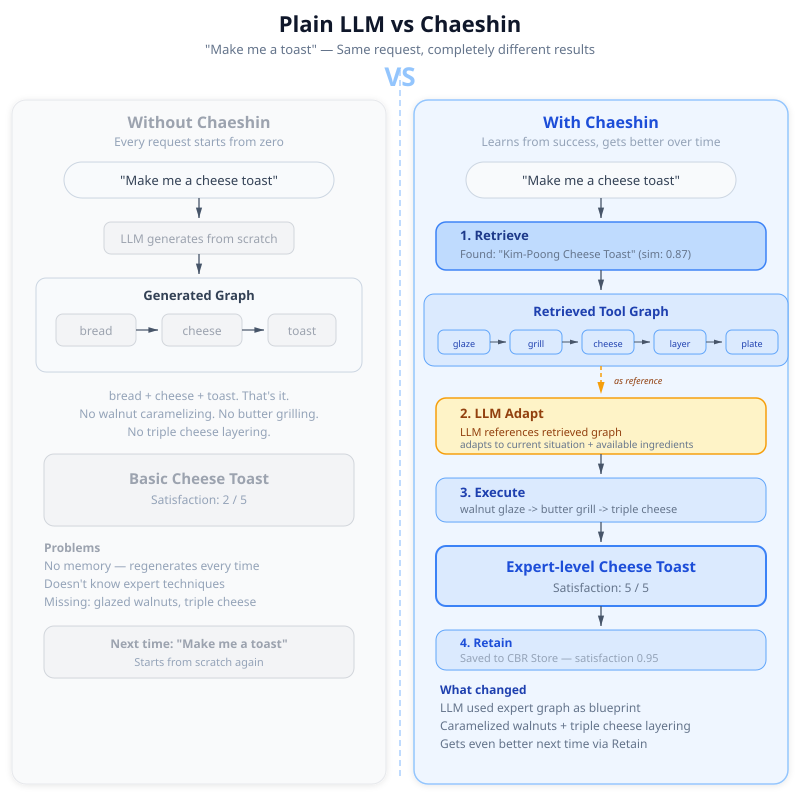
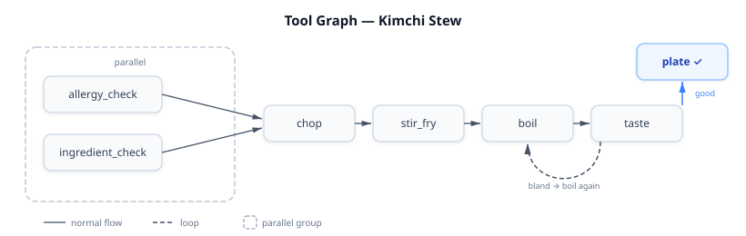
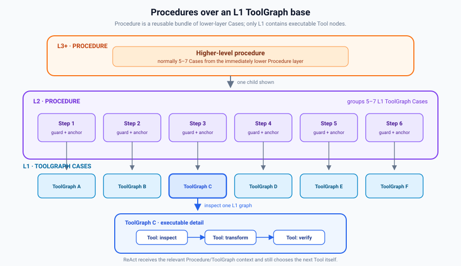
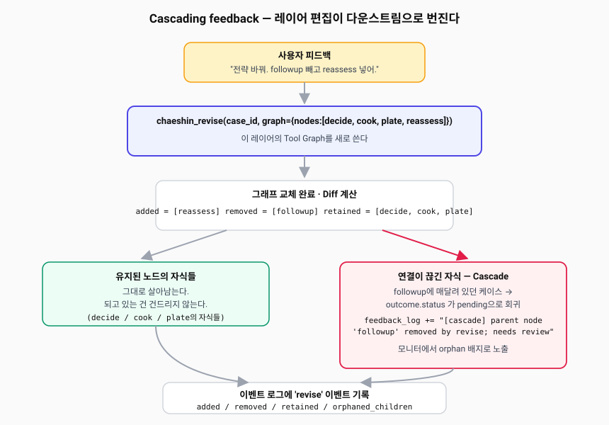
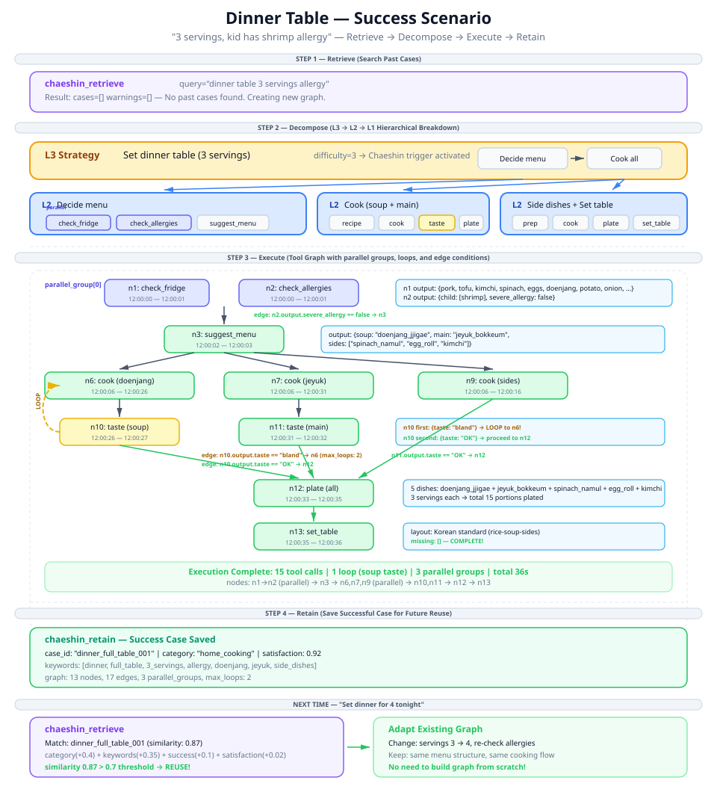
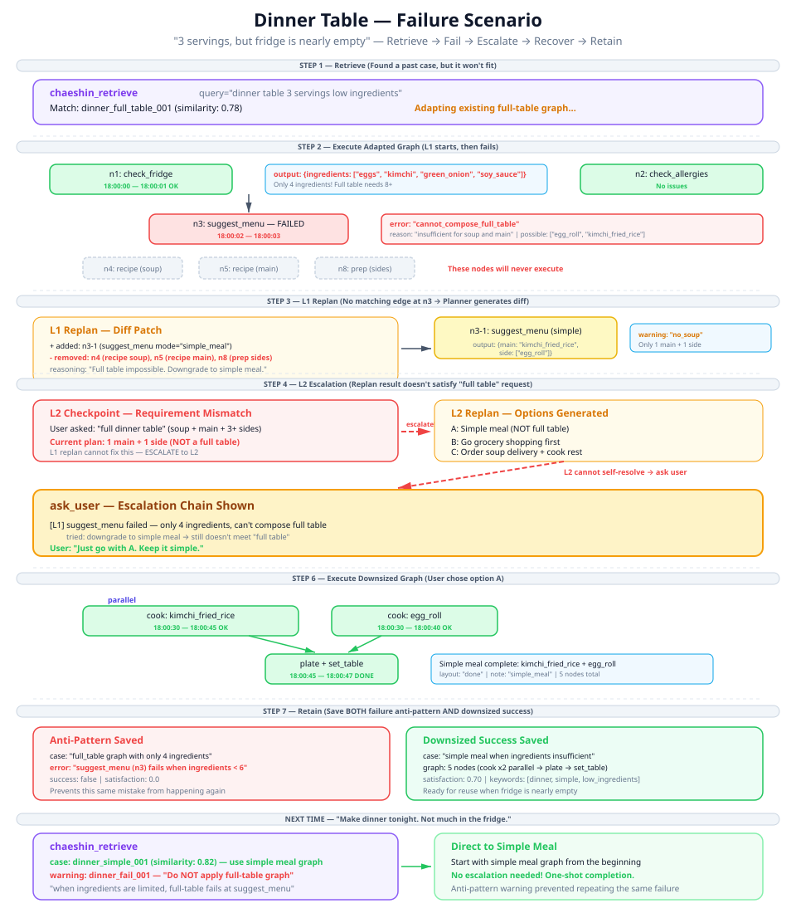
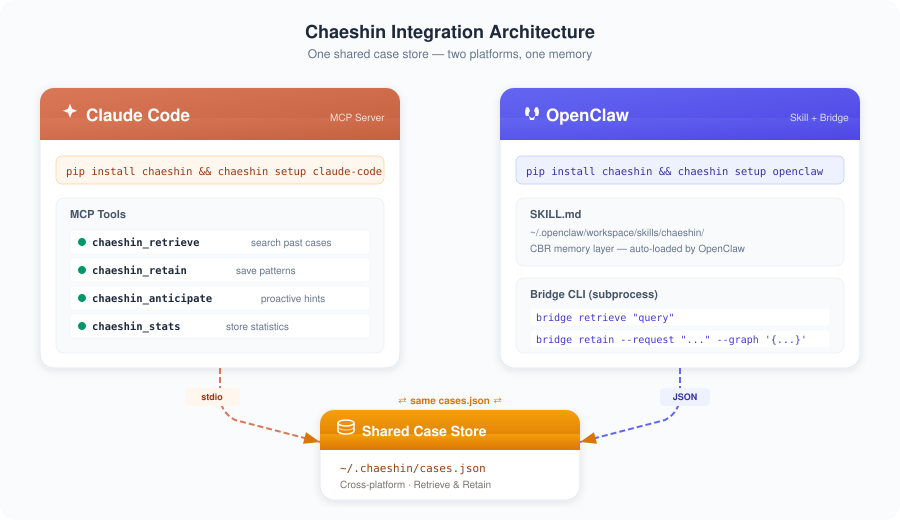

# Chaeshin (채신) 採薪

[](https://doi.org/10.5281/zenodo.19764253)
[](LICENSE)

**Procedural memory context for ReAct agents.** Chaeshin stores successful, failed,
and pending L1 ToolGraph and L2+ Procedure evidence, then retrieves the relevant
context. The host ReAct LLM—not Chaeshin—uses it as reference and chooses each next
Tool directly.

<p align="center">
  
</p>

[한국어](docs/ko/README.md) | [中文](docs/zh/README.md) | [日本語](docs/ja/README.md) | [Español](docs/es/README.md) | [Français](docs/fr/README.md) | [Deutsch](docs/de/README.md)

Layer semantics and retrieval behavior are governed by the
[Architecture Invariants](ARCHITECTURE_INVARIANTS.md).

---

## The Problem

Most LLM agents either **improvise** tool calls on the fly or follow **hardcoded** pipelines:

- **Memoryless ReAct**: Lacks prior procedural evidence and can repeat old mistakes.
- **Hardcoded**: Every new scenario needs code changes. Doesn't scale.

## The Fix

Chaeshin remembers procedural evidence. For a new request it retrieves relevant L1
ToolGraphs and L2+ Procedures, their ProblemFeatures, outcomes, and provenance into
the LLM context. The host ReAct model uses that evidence together with current state
as reference and chooses one next Tool at a time. Chaeshin does not create or execute the runtime plan. This follows the memory
side of [Case-Based Reasoning](https://en.wikipedia.org/wiki/Case-based_reasoning):
**Retrieve → Reuse → Revise → Retain.**

Failures are saved too — so the same mistake never happens twice.

```
Day 1:   Agent improvises everything from scratch
Day 7:   20 cases saved — common patterns are reused
Day 30:  100+ cases — agent rarely improvises, follows proven patterns
```

---

## Quick Start

### 1. Install

```bash
pip install chaeshin
```

### 2. Connect to your agent

```bash
chaeshin setup claude-code       # Claude Code (MCP + auto-learning)
chaeshin setup claude-desktop    # Claude Desktop
chaeshin setup openclaw          # OpenClaw
```

That's it. Claude now automatically:
- **Before** multi-step tasks → retrieves past patterns
- **After** completing tasks → saves the execution graph
- **On failure** → saves the failed pattern so it's never repeated

<details>
<summary>Other install methods</summary>

With [uv](https://docs.astral.sh/uv/) (recommended):

```bash
uv pip install chaeshin
```

With `uvx` (no global install):

```bash
uvx chaeshin setup claude-code --uvx
```

Manual MCP setup (add to `~/.claude.json`):

```json
{
  "mcpServers": {
    "chaeshin": {
      "command": "uv",
      "args": ["tool", "run", "chaeshin-mcp"]
    }
  }
}
```
</details>

<details>
<summary>Use as a standalone library (any agent)</summary>

```python
from chaeshin import CaseStore, ProblemFeatures

store = CaseStore()
store.load_json(open("cases.json").read())

results = store.retrieve(ProblemFeatures(request="send daily PR summary to slack"))
if results:
    graph = results[0][0].solution.tool_graph
```
</details>

### 3. Try the demo

```bash
git clone https://github.com/GEOHYEON/chaeshin.git && cd chaeshin
uv sync --all-extras
uv run python -m examples.cooking.chef_agent   # no API key needed
```

<details>
<summary>Planner-free ReAct + hybrid memory demo (OpenAI)</summary>

```bash
cp .env.example .env         # add your OPENAI_API_KEY
uv run python -m examples.cooking.react_demo
```

The older `examples.cooking.chef_agent_llm` and Gradio app retain the legacy
GraphPlanner path for API compatibility; the primary agent path is ReAct.
</details>

<details>
<summary>Web UI demo (Gradio)</summary>

```bash
cp .env.example .env
uv run python -m examples.cooking.app
```
</details>

See the [Quick Start Guide](docs/quickstart.md) for a full walkthrough.

---

## How It Works

### Tool Graph

Tool calls are structured as a **graph** — not a simple list. Nodes are tool invocations; edges define order and conditions. Loops are supported (e.g., "taste → too bland → cook more → taste again").

<p align="center">
  
</p>

### ToolGraph Base, Procedures Above It

**L1 is always a ToolGraph** and may contain multiple executable tool nodes and
control-flow edges. L2 through LN are Procedures that normally group five to seven
Cases from the layer immediately below. Unfolding a higher Procedure follows its child
anchors until it reaches one or more L1 ToolGraphs. There is no fixed maximum layer.

<p align="center">
  
</p>

L1 is not another name for a single tool call. It is the lowest executable graph, which
can still express sequencing, branches, parallel groups, and loops among real tools.

Under the hood, `metadata.parent_node_id` anchors a lower Procedure or ToolGraph to the node
it expands. Retrieval searches L1 through LN together in one candidate space; it does
not predict a layer first and search only that layer.

### Cascading Feedback — Revise a Procedure or ToolGraph

Revise an L1 ToolGraph or an L2+ Procedure and Chaeshin identifies the anchored
downstream Cases that must be reviewed:

<p align="center">
  
</p>

Orphans aren't deleted — in high-stakes domains a human decides whether to revise,
re-link to a different ProcedureStep, or retire them. Changed steps and anchors are
reported so their lower-layer Cases can be reviewed explicitly.

This is why `chaeshin_revise` is a first-class tool — distinct from
`chaeshin_update`. Structural changes to a ToolGraph or Procedure can affect its
anchored descendants, and Chaeshin does the bookkeeping.

### Immutable Memory Revision + Mutable Situation

A retrieved Procedure or ToolGraph revision does not mutate during a run. After every
Tool Observation, the Host ReAct model refreshes the current Situation and directly
chooses the next Tool again. It may requery Chaeshin when the needed context changes.
Any learned structural change is retained later as a new memory revision; it is not an
in-loop execution plan owned by Chaeshin.

### Diff-Based CRUD

Cases support full Create / Read / Update / Delete:
- `chaeshin_retain` — Create (always as `pending` outcome)
- `chaeshin_retrieve` — Read (split into successes / failures / pending)
- `chaeshin_update(case_id, patch)` — shallow merge; changed fields are recorded in the event log
- `chaeshin_delete(case_id, reason)` — removes a case

### Tri-State Outcome + User Verdict

Chaeshin never *infers* success or failure. Every new case starts as `pending` — the "중간" in-between state. The authoritative verdict comes from the user via `chaeshin_verdict(case_id, "success"|"failure", note)`.

- `wait_mode="blocking"` — wait indefinitely for verdict
- `wait_mode="deadline"` (default, 2h) — after the deadline the case stays `pending` forever; the agent stops blocking on it and moves on

No answer ≠ failure. No answer ≠ success. No answer = **pending** — and that's a first-class state.

### When Things Go Wrong

Real execution does not always match the retrieved precedent. The loop remains simple:

```text
Tool result → refresh Situation → optionally requery all layers → choose one next Tool
```

Chaeshin supplies revised context; ReAct owns the next-action decision. There is no
separate applicability classifier or Planner gate.

---

## Full Example — Setting a Dinner Table

A complete walkthrough: "Prepare dinner for 3, kid has shrimp allergy." Shows every step — retrieve, decompose into layers, parallel cooking, taste-check loops, and failure escalation.

<p align="center">
  
</p>

<p align="center">
  
</p>

Full scenario with step-by-step explanations:
[English](examples/dinner-table/scenario_en.md) ·
[한국어](examples/dinner-table/scenario_ko.md) ·
[日本語](examples/dinner-table/scenario_ja.md) ·
[中文](examples/dinner-table/scenario_zh.md)

---

## Domain Examples

Two long-form walkthroughs showing the same three features (Procedure-over-ToolGraph
decomposition, tri-state outcome, cascading revision) in very different domains.

Each example ships in two flavors:

- `demo.py` — **scripted** walkthrough (no API key needed). Deterministic output, ideal for reading the narrative.
- `react_demo.py` — **live planner-free ReAct agent** using `OPENAI_API_KEY`. The LLM builds a retrieval profile, reads returned Procedures and ToolGraphs together with current state, chooses one next action at a time, and retains only its actual execution trace.

### 🏥 Clinical Lifestyle Intake — high-stakes, long verdict cycle
A clinician-patient flow for newly-diagnosed Type-2 diabetes. Recursive decomposition into intake / stratify / plan / follow-up, FHIR R5 resource hooks, 12-week `pending` verdicts.

[📋 scenario](examples/medical_intake/scenario_ko.md) · scripted: `uv run python -m examples.medical_intake.demo` · live ReAct: `uv run python -m examples.medical_intake.react_demo`

### 🏃 Lifestyle Coaching (non-medical) — chronic fatigue reset
A 3-month reset plan for a burned-out startup PM. Same structure, no medical terminology. Minimum-load planning, cascade revise when the 10-min home workout doesn't stick, failed-habit archive that warns future similar clients.

[📋 scenario](examples/lifestyle_coaching/scenario_ko.md) · scripted: `uv run python -m examples.lifestyle_coaching.demo` · live ReAct: `uv run python -m examples.lifestyle_coaching.react_demo`

### 🍲 Cooking (starter) — kimchi stew, minimal setup
The shortest live example. By default it answers “김치찌개 끓이는 법 알려줘” from
hybrid-retrieved Procedure and ToolGraph context without executing cooking tools or
retaining a fake run.
Change the request to “만들어줘” to see domain actions and actual-trace retention.

Live ReAct: `uv run python -m examples.cooking.react_demo`

All ReAct demos share `examples/_react_common.py` (Chaeshin tool wrappers + store bootstrap) and `chaeshin/agents/react_agent.py` (the Thought / Action / Observation loop with colored console trace). By default the demos write to a temp SQLite; set `CHAESHIN_DEMO_PERSIST=1` to append to `~/.chaeshin/chaeshin.db` so verdicts from the monitor UI apply.

Both medical/lifestyle examples use parallel scenario structure (T0 intake → weekly feedback → cascade revise → final verdict → reuse by similar client), so comparing them side-by-side shows the same engine working in different contexts.

---

## Integrations

All platforms share `~/.chaeshin/cases.json` — cases saved in Claude Code work in OpenClaw and vice versa.

<p align="center">
  
</p>

| Platform | Command | What it does |
|----------|---------|-------------|
| Claude Code | `chaeshin setup claude-code` | MCP server + auto-learning rules (`CLAUDE.md`) |
| Claude Desktop | `chaeshin setup claude-desktop` | Auto-edits `claude_desktop_config.json` |
| OpenClaw | `chaeshin setup openclaw` | Installs `SKILL.md` into workspace |

Available MCP tools after setup:

| Tool | Description |
|------|-------------|
| `chaeshin_retrieve` | Search past cases — returns `successes` / `failures` / `pending` separately |
| `chaeshin_retain` | Save a tool graph. Always starts as `pending` until a verdict arrives |
| `chaeshin_update` | Diff-based partial update (shallow merge, changes logged) |
| `chaeshin_revise` | Commit a new graph revision; previous HEAD is preserved as a snapshot |
| `chaeshin_history` | List HEAD → previous snapshots for a versioned case |
| `chaeshin_diff` | Compare two version case IDs by Tool Graph structure |
| `chaeshin_revert` | Restore an older revision's graph into HEAD as a new commit (by index or tag) |
| `chaeshin_blame` | Per HEAD node, which revision introduced it (git blame) |
| `chaeshin_tag` | Name the current revision (git tag), or list tags — revert by name later |
| `chaeshin_delete` | Remove a case (reason logged) |
| `chaeshin_verdict` | User's `success`/`failure` verdict → flips a pending case |
| `chaeshin_feedback` | Record free-form user feedback (escalate / modify / correct / …) |
| `chaeshin_decompose` | Return recursive-decomposition context for the host AI to execute |
| `chaeshin_stats` | Live case + snapshot counts, outcome-status distribution, overdue-pending count |

---

## Monitor — Observability UI

<p align="center">
  
</p>

A Next.js dashboard over the live SQLite store at `~/.chaeshin/chaeshin.db`. Three views:

| Route | What you see |
|-------|--------------|
| `/` (Cases) | Visual graph editor — drag-and-drop nodes, edges, conditions; full CRUD |
| `/events` | Timeline of every MCP call (retrieve / retain / update / verdict / delete / feedback / decompose). 5-second auto-refresh. Click any row to expand payload + session_id + matched case_ids |
| `/hierarchy` | Recursive case tree. Filter by layer (L1…Ln) and by outcome status (pending / success / failure). Hover a pending case → inline **✓ 성공 / ✗ 실패** buttons to post a user verdict |

```bash
cd chaeshin-monitor && pnpm install && pnpm dev
```

The monitor writes verdicts directly to the same DB the MCP server reads from — so a verdict clicked in the UI immediately affects future `chaeshin_retrieve` rankings.

---

## Architecture

```text
Source evidence → Memory Compiler → L1 ToolGraph + L2...LN Procedure
User query + Situation → all-layer retrieval → bounded Chaeshin Context
bounded Chaeshin Context → Host ReAct → next Tool → Observation ↺
```

<details>
<summary>Project structure</summary>

```
chaeshin/
├── schema.py               # Core data types — tri-state Outcome, recursive CaseMetadata (depth, wait_mode, deadline_at)
├── case_store.py           # CBR 4R cycle + update_case (diff merge) + set_verdict
├── event_log.py            # Every MCP call → SQLite events table (observability)
├── storage/
│   └── sqlite_backend.py   # ~/.chaeshin/chaeshin.db — cases, events, hierarchy_edges, embeddings
├── migrations/
│   ├── m001_json_to_sqlite_l1.py   # Legacy cases.json → SQLite + flat→L1 normalization
│   └── m002_outcome_status.py      # Backfill outcome.status on existing cases
├── graph_executor.py       # Tool graph runner (parallel, loops, conditions)
├── planner.py              # Legacy compatibility API; not loaded by the primary ReAct path
├── cli/                    # chaeshin setup claude-code / claude-desktop / openclaw
├── integrations/
│   ├── claude_code/        # FastMCP server (8 tools) + CLAUDE.md auto-learning template
│   ├── openclaw/           # SKILL.md + bridge CLI
│   ├── openai.py           # LLM + embedding adapter
│   ├── chroma.py           # ChromaDB vector case store (alt backend)
│   └── chaebi.py           # Chaebi marketplace sync
└── agents/                 # Primary ReAct loop + lazy-loaded legacy agent stack
chaeshin-monitor/           # Next.js 15 UI — /, /events, /hierarchy (better-sqlite3 over the same DB)
examples/cooking/           # Demo agent (kimchi stew, doenjang stew, recovery scenarios)
examples/dinner-table/      # Recursive decomposition walkthrough (4 languages)
examples/medical_intake/    # Clinician lifestyle intake → adaptive plan (FHIR-aware)
examples/lifestyle_coaching/ # Chronic-fatigue reset plan — non-medical parallel to medical_intake
```
</details>

## Requirements

- Python 3.10+
- No required dependencies for core usage
- Optional extras:
  - `pip install 'chaeshin[llm]'` — `openai` + `python-dotenv` (needed for ReAct demos and embedding-based retrieval)
  - `pip install 'chaeshin[chroma]'` — ChromaDB vector backend (alternative to embeddings cache)
  - `pip install 'chaeshin[demo]'` — extras for the legacy Gradio cooking demo

## Environment Variables

| Var | Default | Used by |
|-----|---------|---------|
| `OPENAI_API_KEY` | — | `OpenAIAdapter` (LLM + embeddings), all ReAct demos |
| `CHAESHIN_STORE_DIR` | `~/.chaeshin/` | MCP server / migrations — override DB directory |
| `CHAESHIN_DB_PATH` | `~/.chaeshin/chaeshin.db` | Monitor (`better-sqlite3` reader) |
| `CHAESHIN_DEMO_PERSIST` | `0` | Examples — set to `1` so ReAct demos write to the real DB instead of a temp |
| `CHAESHIN_LLM_MODEL` | `gpt-4o-mini` | Override LLM model used by `OpenAIAdapter` |
| `CHAESHIN_EMBEDDING_MODEL` | `text-embedding-3-small` | Override embedding model |

Most demos auto-load a `.env` file via `python-dotenv`. Copy `.env.example` to `.env` to get started.

## Related Work

Chaeshin builds on ideas from:

- [CBR for LLM Agents (2025)](https://arxiv.org/abs/2504.06943) — CBR + LLM integration survey
- [DS-Agent (ICML 2024)](https://arxiv.org/abs/2402.17453) — CBR-based data science agent
- [Voyager (NeurIPS 2023)](https://arxiv.org/abs/2305.16291) — Skill library with experience-driven learning
- [GAP (2025)](https://arxiv.org/html/2510.25320v1) — Parallel tool execution via graphs
- [HTN Plan Repair (2025)](https://arxiv.org/abs/2504.16209) — Hierarchical plan repair

**What's different?** Tool graphs stored as CBR cases, general graphs with loops (not just DAGs), diff-based modification instead of full regeneration, and hybrid execution where code handles normal flow while the LLM only intervenes on exceptions.

## License

MIT — see [LICENSE](LICENSE)

## Citation

If Chaeshin is useful in your work, please cite via the GitHub "Cite this repository" button (which reads [CITATION.cff](CITATION.cff)) or use the Zenodo DOI:

```bibtex
@software{chaeshin,
  author    = {No, Geohyeon},
  title     = {{Chaeshin: Persistent Recursive Case Memory for
                Tool-Using LLM Agents}},
  year      = {2026},
  publisher = {Zenodo},
  version   = {v0.2.0},
  url       = {https://github.com/GEOHYEON/chaeshin},
  doi       = {10.5281/zenodo.19764253}
}
```

- **Concept DOI** [`10.5281/zenodo.19764253`](https://doi.org/10.5281/zenodo.19764253) — always resolves to the latest version.
- **v0.2.0 DOI** [`10.5281/zenodo.19764254`](https://doi.org/10.5281/zenodo.19764254) — frozen snapshot of the v0.2.0 release.

---

*敎子採薪 — Don't give firewood; teach how to gather it.*
